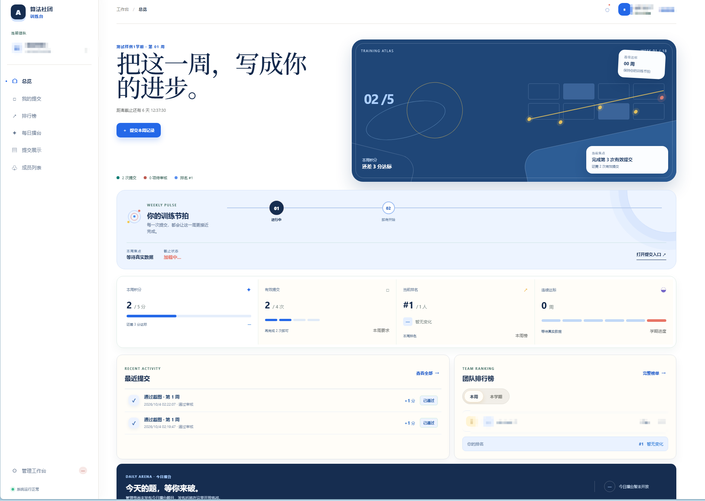
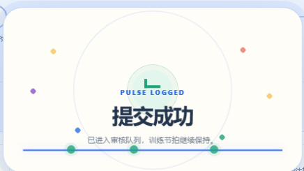

# 算法社团训练台

**A-Algorithm-Club-Training-Platform**

This project was born out of the need to make it easier to compile statistics on members’ training records and to encourage club members to train themselves.

这是一个 Django + PostgreSQL + Celery 的团队训练平台。当前版本保留了原有前端视觉，并提供团队、学期、周次、即时计分、按题目展示、点赞举报、排行榜、成员历史和 Excel 导出接口。

## 界面展示

### 训练总览

工作台以当前周训练目标、积分进度和下一步提交动作作为入口。



### 提交成功反馈

提交成功后，页面会显示明确的反馈状态，并立即计分和展示；被举报后才进入处理队列。



## 本地启动

1. 安装 Docker Desktop，并确保代理可以拉取 Docker Hub 镜像。
2. 复制 `.env.example` 为 `.env`，替换密钥和数据库密码。本地使用 HTTP 时设置 `DJANGO_SECURE_COOKIES=0`、`DJANGO_SECURE_SSL_REDIRECT=0`、`DJANGO_HSTS_SECONDS=0`；正式部署保留 HTTPS 配置。
3. Windows 推荐运行 `powershell -ExecutionPolicy Bypass -File deploy/start.ps1`。脚本会自动使用稳定的传统构建器。
4. 访问 `http://localhost/`。
5. 首次迁移会创建唯一管理员 `admin / admin123`；正式部署前修改默认密码，不再创建第二个超级管理员。

## 账号与权限

全站仅有一个管理员，初始账号 `admin`、密码 `admin123`。所有用户登录后进入同一主界面；系统管理员和团队管理员在左下角使用“管理工作台”。旧 `/manage.html` 地址会跳转到主界面内的工作台。
管理员可以创建/删除团队、设立/取消团队管理用户、管理所有配置项，并拥有所有团队的审核与驳回权限。
管理员查看团队无需加入，也不会占用成员数、影响排行榜。

普通用户自行注册账号，再通过团队码加入团队。注册和加入始终为“普通用户组”。
在主页“成员列表”管理当前团队成员：系统管理员可踢出用户、设置或取消团队管理；团队管理员只能踢出普通用户。系统管理员可切换任意团队。
管理用户归属“团队管理用户组”，只能审核所管理团队的举报，并可在该团队题目详情的“点赞”“举报”旁直接“驳回”提交。
取消某团队权限后保留普通成员身份；若仍管理其他团队，则保留管理用户组，但不能管理已取消权限的团队。

管理员邀请码与团队创建者自动升级机制已删除。普通用户和团队管理用户均不能创建/删除团队或修改全站配置。
全站唯一管理员不能被删除或降级；默认密码只在初始化/本次迁移设置，重启不会重置后续修改的密码。

### 前端工作台栏目

- 团队管理员工作台：举报处理、当前管理团队关联题目的待处理题名（补填题名、选择模式重新解析）。
- 系统管理员工作台：解析与API配置、全站题名待处理（无待办隐藏）、全站举报，以及创建/删除团队和团队计分配置。
- 两类管理员的工作台均不再显示团队成员管理。成员卡片的“踢出用户”“设置/取消团队管理”位于“查看历史提交”左侧；普通用户看不到这些操作。踢出仅停用成员资格，保留历史材料与统计。
- 所有日常配置均在主界面的前端工作台保存，无需进入Django管理后台。API Key仅显示保存状态，留空保留原值。

## 个人信息与算法平台绑定

团队管理员和普通成员点击右上角头像／昵称进入个人信息页。页面从右侧滑入，左上角 `<` 返回时向右滑出，并保留原来的主页面；支持键盘返回、浏览器后退和减少动态效果设置。

昵称仅修改当前团队的展示名，不修改登录账号；同团队昵称不可重复。头像和平台绑定按账号保存，在不同团队间共享。头像支持 PNG、JPEG、WebP（最多 3 MB、1600 万像素），保存为 256×256 JPEG，通过登录后的专属接口读取。

支持 Codeforces、AtCoder、牛客、洛谷、LeetCode。牛客填写数字 UID；洛谷填写 UID 或完整用户名；LeetCode 国际站填写用户名，中国站填写 `cn:用户名`。不包含 QOJ、HDU，不收集第三方密码；洛谷查询 Cookie 由系统管理员在工作台统一配置并加密保存，成员无需填写。绑定只是关联公开账号资料，不是平台官方身份认证。

绑定后由 Celery 异步获取数据，可手动更新绑定、同步及解绑。同一绑定一分钟内不能重复请求；失败保留上次成功快照，超时显示重试提示，解绑或换号后旧任务不能写回数据。页面显示当前／最高 Rating、Rated 比赛数量、最近最多 20 场 Rating 和可用的做题统计。缺失数据用 `—` 表示；部分字段读取失败会显示说明。

统计范围：Codeforces 统计最近最多 1000 次公开提交的去重 AC，牛客统计最近一页公开 AC；AtCoder 使用 AtCoder Problems 的去重 AC，洛谷读取公开通过题目列表，LeetCode 读取累计通过题数与难度分布。卡片会标明统计范围，不能将局部数据视为全站累计。外部接口可能限流或变更，不保证始终可用。

升级需构建并重启 Web 和 Worker，执行增量迁移 `0016_personal_profile`（只新增个人资料与平台绑定表，不清理现有数据）。接口适配参考 OJ-Insight Personal 0.10.2 源码，并针对当前力扣中国站比赛接口与洛谷同域 Cookie 跳转作了适配；许可见 [OJ-Insight MIT License](docs/third-party/OJ-Insight-LICENSE.txt)。

## 题目展示与举报

提交必须填写题目链接并上传通过截图，写题逻辑和在线 Markdown Blog 可选。提交即计分并向当前团队成员展示。
展示列表默认本周，可切换历史周；点击某题会显示该团队该题所有仍保留的历史提交，包含其他周和学期。
题解与 Blog 正文完整展示，支持公式、代码块和图片。Blog 由在线编辑器填写，不再提交站外 Blog 链接。展示以 Blog 为主体，通过截图使用可放大的缩略图，宽度足够时采用三列瀑布流。

每人每条提交最多点赞一次，可取消，不能点赞或举报自己的提交。举报为一键操作，处理前材料继续展示。
团队“举报工作台”可驳回举报，或填写原因整条退回；管理用户也可直接在提交展示中驳回提交；退回后积分及有效次数撤销。
作者仅可在原提交周截止前修改重交，重交清空点赞、生成新版本并保留旧举报历史。
管理员不可处理自己的被举报记录；归档学期不可修改。

## 每日记录、个人维护与浏览

首页节点可横向拖动，显示今天前7天、今天及后3天共11天。今日可重复提交训练记录。历史未签到节点点击“补交当日记录”后先消耗一张补签券，开放一次提交权限，再弹出与今日一致的记录提交窗口。关闭窗口或提交失败时保留权限，再次打开不重复扣券，可在学期内跨周补交（仅保留可见节点入口，已移出显示范围的日期不另设入口）；提交成功才创建补签签到记录、计入训练积分，并重新核算所在自然周连签奖励。成功后的按钮显示“当日已补签”并禁用；重复请求、删除记录均不会恢复该次权限。无券时弹窗引导前往 RBC 商店，已持有的下架券仍可使用。学期结束或归档后不能继续补交。数据库迁移：0024_makeup_submission_permission。

“我的提交”的查看窗口有专属编辑、删除标签，提交展示和成员历史查看不提供这些个人操作。编辑保留原归属日期，未换截图时复用原截图，更新版本、清空旧点赞并重新计分；编辑和重交受原周截止限制。删除整条记录会同步撤销积分、有效次数和达标统计，附件进入持久清理清单。

排行榜点击成员可打开成员历史。二级窗口提供返回上级按钮，Markdown 编辑器保持其原有独立操作。提交表单下方有力扣每日一题（接口获取当日链接）与牛客每日一题入口。

## 全站题名解析

系统管理员登录主界面后，点击左下角“管理工作台”，在“题目解析与 API 配置”栏选择：

- 自动解析：读取公开网页题名；优先适配牛客、洛谷、LeetCode、Codeforces、AtCoder。
- AI解析：仅发送网址和固定 Prompt，要求配置的服务具有联网读取能力。
- 智能解析（默认）：自动解析失败后调用AI。

AI配置填写 API Base URL（例如 `https://api.example.com/v1`）、API Key 和 Model。
调用协议可选 `Chat Completions` 或 `Responses（启用联网搜索）`：前者使用 `POST /chat/completions` 和 `choices[0].message.content`；后者使用 `POST /responses`，显式携带 `web_search` 工具并读取 `output_text`。两者均使用 Bearer 鉴权。CPA/Codex 服务经实测可通过 Responses 执行联网取名；支持范围仍取决于所配置上游。
Key加密保存；留空保留原值，页面只显示掩码。加密密钥派生自 `DJANGO_SECRET_KEY`，更换该密钥后需重新填写API Key。
在前端保存配置后，点击“测试已保存的 AI 配置”。测试会发送牛客示例题目网址，可能产生一次API调用费用；连接成功但模型返回空题名时，会单独提示未能确认题名。

题名解析通过 Celery 执行，不阻塞提交。已记录的题目不会因重复提交、切换模式或修改配置而重复请求。
未取得题名时显示网址。前端工作台的“待处理题目名称”栏展示失败或处理中的题目，可直接补填题名或选择模式重新解析；系统管理员处理全站题目，团队管理员只处理当前管理团队提交关联的题目。没有待处理项时整栏隐藏。
人工修改会阻止迟到任务覆盖；重试失败不会清除已有题名。待处理队列支持删除命名任务：保留题目与提交记录，并取消旧任务写回；没有题名时继续显示原题链接。

## 正式部署

将项目上传到 Debian 12 服务器，配置 `.env` 中的域名和密码，开放 80/443 端口后运行 Docker Compose。Nginx 负责反向代理和媒体文件，PostgreSQL、Redis、Celery Worker/Beat 由 Compose 管理。

生产环境 `.env` 至少需要设置：

```dotenv
DJANGO_ALLOWED_HOSTS=redbloodcell.cn,www.redbloodcell.cn
DJANGO_CSRF_TRUSTED_ORIGINS=https://redbloodcell.cn,https://www.redbloodcell.cn
DJANGO_SECURE_COOKIES=1
DJANGO_SECURE_SSL_REDIRECT=1
DJANGO_HSTS_SECONDS=31536000
```

如果前面使用 Cloudflare，请将 SSL 模式设为 Full (strict)，并确保 Cloudflare 的 `X-Forwarded-Proto` 被 Nginx 转发给 Django。

更新前端或后端后，需要重新构建 Web、Worker、Beat 镜像并重启 Compose 服务；只替换浏览器里的 HTML 不会更新服务器数据库接口。

HTTPS 证书可以用 Certbot 写入 `deploy/certbot/conf`，证书更新后重新加载 Nginx。

## 升级注意

**迁移 `0010_account_roles` 会一次性清空所有旧账号、成员关联、训练记录、积分、审核日志及登录会话，仅保留唯一管理员 `admin / admin123`。**
现有团队、学期、周次、题名缓存与AI配置保留，团队归属转移给管理员；原管理员邀请码不再使用。
该清理不可回滚，仅执行一次。此后新注册用户和重新分配的管理权限在重启后保留。


**迁移 `0008_community_library` 会在所有升级环境一次性删除全部历史提交、材料、审核日志、积分汇总和擂台数据。**
账号、团队、成员、学期、周次和计分配置保留，历史积分及达标次数归零。该数据清空不可回滚。
先停止 Worker / Beat，再构建新版 Web 并运行迁移和 collectstatic，最后恢复 Worker / Beat 并重新启动 Nginx。
Web 启动命令已包含迁移和 collectstatic；本地启动脚本使用项目名 `club-platform`。

迁移将待删除文件写入 FileDeletion 清单，由每分钟后台任务分批删除；失败保留并重试。
可在站点后台检查清理清单，或运行 `docker compose -p club-platform exec web python manage.py shell -c "from club.tasks import purge_files; purge_files()"` 立即尝试清理。
后续普通重启不会删除新记录。

周次按上海时区每周一00:00切换，截止后禁止提交或重交；周次日期异常仍需通过 `repair_weeks` 人工检查修复。
清理改为管理员在“团队配置”中设置具体北京时间，实际执行时间为所选时间加7天。设置后显示剩余天数，可在实际执行前撤销并重设；未设置不自动清理。清理提交、截图、写题逻辑、Blog、点赞举报及审核明细，保留账号、团队、学期周次、学期汇总和全站题名缓存。附件只通过受权限保护的 `/api/attachments/<id>` 提供。

迁移 `0014_manual_cleanup_schedule` 会取消未归档学期的旧自动清理计划，不删除这些学期的提交。管理员须重新设置清理时间；已归档学期失败的文件清理仍可重试。

## 回归测试

使用独立 PostgreSQL 测试数据库运行 `python manage.py test club`，不要使用生产数据库账号。
测试覆盖新展示、即时计分、举报退回、截止、题名模式与缓存、API模拟、并发、权限、迁移清空和文件清理重试。
实际AI联网能力需配置真实API后单独验证；模拟API测试不代表外部服务可联网。

个人比赛进度、AC 领奖、年级自动晋升和自然周连签奖励见 [比赛日程说明](docs/contest-calendar.md)。升级需运行迁移 0017–0019 并同步重启 Web、Worker、Beat。

个人信息支持验证旧密码后修改密码；年级仅注册可选。提交展示支持对同团队其他成员的有效未归档提交打赏正整数 RBC Coins：双方余额与流水在同一事务更新，同一请求重试不重复扣款。升级需迁移 `0022_submission_tips`。

### 拓展资源墙

菜单“拓展”为全站共享资源墙，每个资源占一个正方形格子。系统管理员可在该页添加、编辑、删除资源，配置名称、简介、可选封面，以及 HTTP/HTTPS 超链接或下载文件。普通成员和团队管理员仅可浏览、下载。文件与封面不设上传大小上限，封面支持 PNG/JPEG/WebP，封面会转换为正方形 JPEG。文件通过登录与成员权限校验后以附件下载，删除或替换的文件进入现有文件清理队列。数据库迁移：0023_extension_resources。


### 比赛日程与排行榜更新

比赛日程由 Celery Beat 每日北京时间06:00、18:00触发后台更新，五个平台的数据及更新时间保存在数据库。打开日程只读取已有快照，不等待平台请求；更新失败保留最近成功数据。手动“刷新日程”沿用原缓存逻辑：成功15分钟内复用，失败60秒后可重试。新部署后可调用 `club.tasks.refresh_contest_calendar.delay()` 异步初始化，之后由定时任务维护。迁移：0025_persisted_contest_calendar。

排行榜分为签到榜（当前连续签到天数，包含有效提交和已完成补签）、Rating榜（按平台分别排序，绑定但暂无评级的成员放末尾）、财富榜（当前团队的Coins余额）。仅当前团队活跃成员参与，排行榜独立于训练学期。LeetCode中国站和国际站分别展示。个人题号的待领奖抖动加强，收起时比赛框沿用原动画；遵循系统减少动态效果设置。


### 稳定性复核（2026-10-29）

每日首次有效提交接入已有签到服务；多次提交不重复发每日奖励，历史补签只重算原周。连签凭证按团队、用户、自然周和档位持久去重。商店购买支持可选UUID请求编号，前端会在未知网络结果后复用编号，防止重复扣款；不带编号的旧调用仍按独立订单处理。迁移 `0026_audit_reward_consistency` 回填现有周奖励的团队与用户，不重新发币。

修正洛谷 `contestProblems`、比赛归属与提交者校验，以及牛客题库实际分页和多次AC时间保留。AtCoder镜像空数据会标记无法完整核验，不清空此前可靠进度。日程、个人平台同步优先处理；大型历史同步按最近一次进展检测超时。详细审查结论见 `docs/audits/2026-10-29-稳定性审查报告.md`。


时间核验兜底（2026-10-29最新要求）：有可靠AC记录但无法核验作答时间时，统一允许按对应难度档位领取；有准确时间且明确赛外的记录仍不发奖。洛谷提交时间查询失败时可使用已确认的公开AC清单兜底；无法证明AC则不发奖。此规则覆盖旧文档中“缺少时间暂不可领取”的说明。注册年级、账号绑定、比赛起始日期及去重限制继续有效。

管理员工作台的完整备份、恢复及强制退出改密说明见 [系统备份与管理员密码](docs/system-backup.md)。
